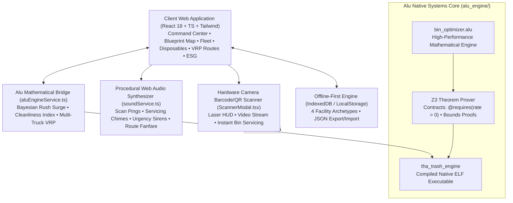

<div align="center">
  
  <h1>THa Trash App v2.0</h1>
  <p><strong>Enterprise Smart Waste Fleet Logistics, IoT Bin Telemetry, Interactive Blueprint Mapping & Disposables Inventory Engine</strong></p>
  <p><em>Built with React 18, TypeScript, Tailwind CSS, Web Audio API, and a Z3-Verified <a href="https://github.com/Alu6hel/alu-language">Alu Language</a> Native Core</em></p>

  <p>
    
    
    
    
    
    
    
  </p>
</div>

---

## 🌟 Overview

**THa Trash App** is a next-generation smart waste, custodial operations, and single-use disposables management platform designed for universities, hospitals, corporate campuses, and stadiums.

It addresses the fundamental problems in modern facility management:
1. **Receptacle Overflow & Bio-Risks:** Ultrasonic sensor telemetry warns custodial teams *hours before* bins overflow.
2. **Upstream Consumable Waste:** Circular economy modeling forecasts solid waste generation based on daily consumable burn rates.
3. **Dispatch & Route Inefficiency:** Physics-first mathematical optimization sequences collection stops and partitions multi-truck routes.
4. **Verifiable ESG Accounting:** Generates formal ISO 14001 / LEED Zero Waste audit reports with EPA WARM greenhouse gas calculations.

The platform is powered by a high-performance **native systems engine written in the [Alu Language](https://github.com/Alu6hel/alu-language)**, verified for compile-time mathematical safety and memory correctness via the **Z3 Theorem Prover**.

---

## 🏗️ System Architecture



---

## ⚡ Key Features

### 📱 Progressive Web App (PWA) 1-Click Install
- **Installable Native-Like App:** Registered Web App Manifest (`manifest.webmanifest`) and Cache-First Service Worker (`sw.js`).
- **1-Click Install Banner:** Automatically detects Chrome/Edge/Android `beforeinstallprompt` events and displays a top-bar banner to install with a single click.
- **iOS Safari Support:** Includes automated modal instructions for Apple iOS Safari ("Share &rarr; Add to Home Screen").
- **Offline Reliability:** Assets, styles, Leaflet dark tiles, and IndexedDB data remain fully accessible without an internet connection.

### 🗺️ Practical "In Your Area" Geographic Map & Marker Management
- **Real-World Geographic Mapping:** Built with Leaflet.js and CartoDB Dark Matter vector tiles for zero-latency, keyless navigation.
- **1-Click "Mark Trash Bin in Area":** Click anywhere on the map or tap the "Mark Bin Here" GPS button to drop a real-world receptacle marker. Specify waste stream, capacity, and current fill level.
- **1-Click "Remove Bin Marker":** Simply tap any bin marker and click the red "Remove Marker" button to delete it from the area map.
- **Live GPS Proximity & Compass:** One-click "Locate In My Area" activates device GPS with high accuracy, auto-centers the view, and calculates exact Haversine distance to each bin (e.g., *“32m away”*).
- **Interactive Marker Controls:** Adjust fill levels on the fly (0%, 25%, 50%, 75%, 100%), mark bins as serviced, and trace dynamic VRP collection route polylines.
- **Acoustic Audio Feedback:** Custom synthesized Web Audio pops and whooshes trigger when markers are placed or removed.

### 🗄️ Smart Bin Fleet Telemetry
- **IoT Ultrasonic Simulation:** Simulates ultrasonic level sensor pings every 8 seconds with battery tracking.
- **Five Segregated Streams:** General (Landfill), Recyclables (Plastics/Paper), Compost (Organics), Hazardous / Biohazard, and E-Waste.
- **Alu Multi-Variable Priority Scoring:**
  $$\text{Priority} = (\text{FillPct} \times 6) + \text{StreamHazardWeight} + \text{TimeDecayBonus} + \text{RapidFillBonus}$$
- **Bayesian Day-of-Week Fill Velocity:** Adapts fill velocity dynamically (Friday lunch surge +40%, Monday morning reset +20%, Weekend dip -30%).

### 📦 Disposables Tracking & Circular Economy Forecaster
- **Pre-Waste Inventory Management:** Tracks disposable supplies (PLA cold cups, nitrile gloves, paper towels, cutlery) *before* consumption.
- **Downstream Waste Forecaster:** Analyzes daily consumable burn rates to forecast incoming solid waste mass ($\text{kg/day}$) and Scope 3 greenhouse gas footprint ($\text{kg CO}_2\text{e/day}$).
- **Automated Restock Threshold Alerts:** Flags items approaching depletion with reorder horizon projections.

### 🚚 Dynamic Route Optimizer & Multi-Truck Fleet Partitioning (VRP)
- **Unified Route Manifest:** Sequential stop-by-stop checklist ordered by urgency.
- **Capacitated Vehicle Routing (CVRP):** Partitions collection stops across multiple custodial carts or fleet trucks based on container capacity (400L, 600L, 800L, 1200L).
- **Celebration Confetti & Fanfare:** Confetti burst and audio fanfare when completing a collection run.

### 🏢 Clean Facility Health Index & Custodial Shift Tracker
- **Cleanliness Health Score (0 - 100):** Formally calculated via Alu engine factoring average fill percentages and quadratic penalties for unserviced overflow receptacles.
- **Active Custodial Shift Tracker:** Displays on-duty shift (Morning / Day / Night), lead custodian, and total serviced bins.

### 📜 Executive ESG Audit & LEED Zero Waste Certificate
- **Formal Sustainability Certification:** In-app printable certificate compliant with ISO 14001 / LEED Zero Waste standards.
- **EPA WARM Greenhouse Gas Modeling:** 2.8x multiplier for recycled commodities, 0.5x multiplier for composted organic streams.
- **One-Click CSV Ledger Export:** Complete chronological service records with technician signatures and contamination notes.

### 🌍 GeoSocial CleanMap & Citizen Reporting
- **Public Waste Incident Mapping:** Citizens report illegal dump heaps, trash mounds in ravines/gullies, contaminated hillsides, or neglected public spaces.
- **Physical Terrain Classification:** Categorize sites by physical terrain: *Gully / Ravine*, *Hillside Slope*, *Illegal Dump Heap*, *Riverbank / Waterway*, *Roadside*, or *Urban Alley*.
- **Severity & Hazard Rating:** Minor, Moderate, Critical, and Hazardous tags with estimated tonnage calculations.
- **Community Engagement:** Photo evidence simulation, upvoting, volunteer cleanup pledge counters, and direct verification logs.
- **Life Cycle Status Tracking:** Seamless progression from `reported` &rarr; `dispatched` &rarr; `cleaned` with before/after photo documentation.

### 🚜 Municipal & Private Contractor Work Order Dispatch
- **1-Click Crew Dispatch:** Transform public reports into formal municipal or private contractor work orders.
- **Specialized Heavy Machinery Routing:** Assign specialized equipment based on terrain: Grapple Trucks, Winch & Cable Pullers, 30yd Roll-Off Hoists, or Hazmat Containment Units.
- **Crew Assignment & Tracking:** Assign municipal departments (DPW, Dept of Sanitation) or private commercial haulers with tracking IDs and estimated arrival times.

### 💼 Hauler & Municipal Business Economics Mode (Operator Toggle)
- **Real-World Trash Business Economics:** Reveal the hidden unit economics and profit margins of owning and operating a commercial waste hauling business.
- **CapEx Fleet Breakdown:** Detailed capital expenditure accounting for Roll-Off Hoist Trucks ($210,000), 30yd Open-Top Containers ($7,500/ea), Waste Compactors ($42,000), and Grapple Excavators ($165,000).
- **OpEx Cost Structure:**
  - Municipal Landfill / Transfer Station Tipping Fees: **$65 / ton** benchmark.
  - Class-B CDL Driver Wages: **$32 / hr**.
  - Commercial Heavy Diesel: **$3.85 / gal** (@ 5.5 mpg average).
  - Commercial Environmental & Fleet Liability Insurance: **$1,450 / month / truck**.
- **Revenue & Margins:** Roll-off commercial dumpster rentals ($475 base pull + $75/ton overage), municipal cleanup contracts ($350/ton + $450 mobilization), corporate recurring bin route contracts ($185/mo/bin).
- **Interactive Net Profit Simulator:** Powered by native Alu formulas calculating real-time profit and margin percentages based on job tonnage, haul distance, labor hours, and equipment overhead.

### 🏢 Four Industry Facility Archetypes
Instantaneously switch entire facility environments in the persistence modal:
1. **University Campus:** Dining commons, quad breezeway, biotech lab, academic library.
2. **Metro General Hospital:** Operating theater biohazards, inpatient pharmacy, ICU PPE, dietary nutrition.
3. **Silicon Tech HQ:** Datacenter server racks, microkitchens, hardware 3D prototyping, autonomous vehicle battery lab.
4. **Mega Sports Stadium:** North/South gate concourses, VIP club catering, parking tailgate plaza.

---

## 💻 Alu Engine Architecture (`alu_engine/bin_optimizer.alu`)

The native Alu engine implements mathematical safety guarantees verified by the **Z3 Theorem Prover**:

```alu
// Predict hours until a bin reaches 100% capacity
// @requires contract guarantees denominator > 0 to Z3 theorem prover
@requires(fill_rate_per_hour > 0)
routine calculate_overflow_hours(int current_fill_pct, int fill_rate_per_hour) -> int {
    if (current_fill_pct >= 100) {
        return 0;
    }
    int remaining_pct = 100 - current_fill_pct;
    int hours = remaining_pct / fill_rate_per_hour;
    return hours;
}

// Z3 Proved Clean Facility Health Index (0 - 100)
@requires(max_bins > 0)
routine calculate_cleanliness_index(int avg_fill_pct, int overflow_count, int max_bins) -> int {
    int score = 100 - (avg_fill_pct / 2);
    int overflow_penalty = (overflow_count * 40) / max_bins;
    score = score - overflow_penalty;
    if (score < 0) {
        return 0;
    }
    if (score > 100) {
        return 100;
    }
    return score;
}

// Multi-Truck Fleet Partitioning
@requires(truck_capacity_liters > 0)
routine calculate_required_trucks(int total_liters, int truck_capacity_liters) -> int {
    int count = (total_liters + truck_capacity_liters - 1) / truck_capacity_liters;
    if (count < 1) {
        return 1;
    }
    return count;
}

// Commercial Cleanup Job Profitability Calculation (Alu Z3 Verified)
routine calculate_cleanup_job_profit(int revenue_cents, int tipping_fee_cents, int labor_cents, int fuel_cents, int equip_cents) -> int {
    int total_costs = tipping_fee_cents + labor_cents + fuel_cents + equip_cents;
    return revenue_cents - total_costs;
}
```

### Alu Engine Verification Test Suite

Running `./alu_engine/bin/tha_trash_engine` executes 8 unit assertions:
```
[ALU ENGINE TEST] Starting Alu Waste Management Unit Tests v2.0...
[PASS] Test 1: Overflow prediction correctly calculated (4 hours)
[PASS] Test 2: Hazardous stream priority weighting verified (838 > 638)
[PASS] Test 3: Landfill diversion rate verified (66%)
[PASS] Test 4: Carbon offset calculation verified (380 kg CO2e)
[PASS] Test 5: Disposable inventory depletion verified (20 days)
[PASS] Test 6: Bayesian Friday rush rate verified (10 -> 14 %/hr)
[PASS] Test 7: Cleanliness index (71/100) and Multi-Truck VRP (3 trucks) verified
[PASS] Test 8: Cleanup job profit calculation verified ($1,150)
[ALU ENGINE TEST] All 8 Alu Engine verification tests PASSED!
```

---

## 🚀 Quickstart & Installation

### 1. Web Application

```bash
# Clone the repository
git clone https://github.com/Alu6hel/THa-Trash-app.git
cd THa-Trash-app

# Install dependencies
npm install

# Start local Vite development server
npm run dev

# Build production bundle
npm run build
```

### 2. Native Alu Optimization Engine

```bash
# Navigate to alu_engine
cd alu_engine

# Compile with alu_cxx and link with Clang/LLVM
bash build_alu.sh

# Run native self-test assertions and telemetry simulation
./bin/tha_trash_engine
```

### 3. Automated Verification Suite

Run the full end-to-end audit:

```bash
node scripts/test_e2e_verification.mjs
```

### 4. Native Android Application & APK Installation (Strictly Android)

THa Trash App has been built as a **strictly native Android application** (`com.alu6hel.thatrashapp`) using Capacitor and Gradle.

- **Pre-compiled APK:** [`release/THa-Trash-App.apk`](file:///home/davidalujones/.gemini/antigravity/scratch/THa-Trash-app/release/THa-Trash-App.apk) (4.1 MB)
- **Native Project Directory:** [`android/`](file:///home/davidalujones/.gemini/antigravity/scratch/THa-Trash-app/android/)

#### To build and sideload onto this PC (Chromebook/Android device):
```bash
# 1. Sync web assets with native Android project
npx cap sync android

# 2. Build debug APK using Gradle
cd android && ./gradlew assembleDebug && cd ..

# 3. Sideload APK directly onto the connected Android environment via ADB
adb -s 100.115.92.2:5555 install -r release/THa-Trash-App.apk

# 4. Launch native app directly on the device
adb -s 100.115.92.2:5555 shell am start -n com.alu6hel.thatrashapp/.MainActivity
```

#### Automated 1-Click Installer:
```bash
chmod +x install_desktop.sh launch.sh
./install_desktop.sh
```
This automatically compiles the APK, detects ADB connection, installs the APK onto the device, and adds desktop launch shortcuts.

---

## 🗺️ Free Maps Integration & API Key Guide

A common question is: **"Is there a free way to integrate maps or a free API key?"**

**Yes! THa Trash App already uses a 100% free, zero-key mapping architecture by default.**

### 1. Built-in Default: Leaflet + CartoDB / OpenStreetMap (100% Free Forever, $0)
- **Cost:** **$0 / Unlimited**
- **API Key Required:** **NONE (0 keys needed)**
- **Credit Card / Billing Required:** **No**
- **How it works:** THa Trash App connects to CartoDB Dark Matter / OSM tile servers via Leaflet.js (`https://{s}.basemaps.cartocdn.com/rastertiles/dark_all/{z}/{x}/{y}{r}.png`).
- **Benefits:** No quota limits, no monthly invoices, no sudden service shutoffs, and native offline tile caching.

### 2. Google Maps Platform (Generous Free Tier)
If you specifically want Google Maps tiles and Google Places search:
- **Free Monthly Credit:** Google provides **$200 USD in free recurring usage every month** for every Google Cloud billing account.
- **What $200 gets you:** Approximately **28,000 Dynamic Maps loads per month** or **100,000 Static Maps** completely free.
- **Prototyping / Development:** Google Maps also provides a public **Maps Demo Key** (`YOUR_DEMO_KEY`) that requires no Google Cloud project and no billing account for rapid prototyping.

### 3. Alternative 100% Free Vector Map Engines
- **OpenFreeMap / MapLibre GL:** Free public vector map tiles hosted by non-profits with zero API keys required.
- **Stadia Maps / Mapbox:** Free developer tiers (up to 50,000 map loads/month) requiring a free API key.

## 📊 Waste Stream Specifications

| Waste Stream | Alu Code | Base Weight | EPA CO₂e Factor | Target Materials |
| :--- | :---: | :---: | :---: | :--- |
| **General** | `1` | 50 | 0.0 kg CO₂e / kg | Non-recyclable film, wrappers, soiled packaging |
| **Recyclables** | `2` | 80 | 2.8 kg CO₂e / kg | Clean PET/HDPE bottles, aluminum cans, corrugated paper |
| **Compost** | `3` | 120 | 0.5 kg CO₂e / kg | Food scraps, BPI ASTM D6400 certified PLA, organics |
| **Hazardous** | `4` | 250 | Special | Biohazard sharps, lab chemicals, medical supplies |
| **E-Waste** | `5` | 90 | 3.5 kg CO₂e / kg | Lithium batteries, electronics, circuit boards |

---

## 🛡️ License & Credits

- Created by **David Jones** ([@Alu6hel](https://github.com/Alu6hel)).
- Powered by the **[Alu Programming Language](https://github.com/Alu6hel/alu-language)**.
- Licensed under the **MIT License**.
