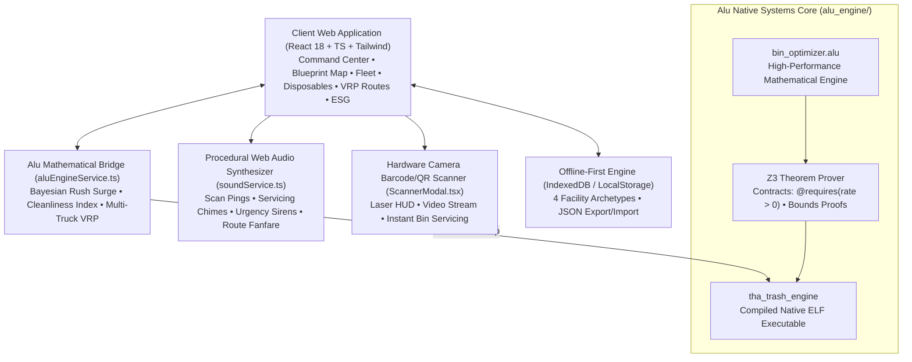

<div align="center">
  
  <h1>THa Trash App v2.0</h1>
  <p><strong>Enterprise Smart Waste Fleet Logistics, IoT Bin Telemetry, Interactive Blueprint Mapping & Disposables Inventory Engine</strong></p>
  <p><em>Built with React 18, TypeScript, Tailwind CSS, Web Audio API, and a Z3-Verified <a href="https://github.com/Alu6hel/alu-language">Alu Language</a> Native Core</em></p>

  <p>
    
    
    
    
    
    
  </p>
</div>

---

## 🌟 Overview

**THa Trash App** is a next-generation smart waste, custodial operations, and single-use disposables management platform designed for universities, hospitals, corporate campuses, and stadiums.

It addresses the fundamental problems in modern facility management:
1. **Receptacle Overflow & Bio-Risks:** Ultrasonic sensor telemetry warns custodial teams *hours before* bins overflow.
2. **Upstream Consumable Waste:** Circular economy modeling forecasts solid waste generation based on daily consumable burn rates.
3. **Dispatch & Route Inefficiency:** Physics-first mathematical optimization sequences collection stops and partitions multi-truck routes.
4. **Verifiable ESG Accounting:** Generates formal ISO 14001 / LEED Zero Waste audit reports with EPA WARM greenhouse gas calculations.

The platform is powered by a high-performance **native systems engine written in the [Alu Language](https://github.com/Alu6hel/alu-language)**, verified for compile-time mathematical safety and memory correctness via the **Z3 Theorem Prover**.

---

## 🏗️ System Architecture



---

## ⚡ Key Features

### 🗺️ Interactive Facility Blueprint & Telemetry Map
- **Architectural Vector Floor Plan:** Vector SVG rendering of facility wings (Dining, Courtyard, Biotech Labs, Library, Recreation Center, Makerspace).
- **Live Halo Status Rings:** Visual alerts dynamically change based on bin capacity:
  - `Normal (<70%)`: Steady calm ring
  - `Attention (70-89%)`: Pulsing amber caution ring
  - `Overflowing (≥90%)`: Rapid pulsing red hazard halo
- **Animated Collection Route Trail:** Draws an SVG polyline connecting scheduled stops in optimal dispatch order.
- **Click-to-Place Repositioning:** Custodians can click any bin marker, activate repositioning mode, and click anywhere on the blueprint to update coordinates.

### 📷 Live Hardware Camera QR & Barcode Scanner
- **Targeting Laser Viewfinder:** Uses device video feed (`facingMode: 'environment'`) with laser scanline animations and corner brackets.
- **Instant Match & Action:** Scanning a bin or disposable packaging triggers immediate service/restock actions.
- **Audio Feedback:** Real-time audio chirps and chimes generated directly via the browser's Web Audio API without external audio files.

### 🗄️ Smart Bin Fleet Telemetry
- **IoT Ultrasonic Simulation:** Simulates ultrasonic level sensor pings every 8 seconds with battery tracking.
- **Five Segregated Streams:** General (Landfill), Recyclables (Plastics/Paper), Compost (Organics), Hazardous / Biohazard, and E-Waste.
- **Alu Multi-Variable Priority Scoring:**
  $$\text{Priority} = (\text{FillPct} \times 6) + \text{StreamHazardWeight} + \text{TimeDecayBonus} + \text{RapidFillBonus}$$
- **Bayesian Day-of-Week Fill Velocity:** Adapts fill velocity dynamically (Friday lunch surge +40%, Monday morning reset +20%, Weekend dip -30%).

### 📦 Disposables Tracking & Circular Economy Forecaster
- **Pre-Waste Inventory Management:** Tracks disposable supplies (PLA cold cups, nitrile gloves, paper towels, cutlery) *before* consumption.
- **Downstream Waste Forecaster:** Analyzes daily consumable burn rates to forecast incoming solid waste mass ($\text{kg/day}$) and Scope 3 greenhouse gas footprint ($\text{kg CO}_2\text{e/day}$).
- **Automated Restock Threshold Alerts:** Flags items approaching depletion with reorder horizon projections.

### 🚚 Dynamic Route Optimizer & Multi-Truck Fleet Partitioning (VRP)
- **Unified Route Manifest:** Sequential stop-by-stop checklist ordered by urgency.
- **Capacitated Vehicle Routing (CVRP):** Partitions collection stops across multiple custodial carts or fleet trucks based on container capacity (400L, 600L, 800L, 1200L).
- **Celebration Confetti & Fanfare:** Confetti burst and audio fanfare when completing a collection run.

### 🏢 Clean Facility Health Index & Custodial Shift Tracker
- **Cleanliness Health Score (0 - 100):** Formally calculated via Alu engine factoring average fill percentages and quadratic penalties for unserviced overflow receptacles.
- **Active Custodial Shift Tracker:** Displays on-duty shift (Morning / Day / Night), lead custodian, and total serviced bins.

### 📜 Executive ESG Audit & LEED Zero Waste Certificate
- **Formal Sustainability Certification:** In-app printable certificate compliant with ISO 14001 / LEED Zero Waste standards.
- **EPA WARM Greenhouse Gas Modeling:** 2.8x multiplier for recycled commodities, 0.5x multiplier for composted organic streams.
- **One-Click CSV Ledger Export:** Complete chronological service records with technician signatures and contamination notes.

### 🏢 Four Industry Facility Archetypes
Instantaneously switch entire facility environments in the persistence modal:
1. **University Campus:** Dining commons, quad breezeway, biotech lab, academic library.
2. **Metro General Hospital:** Operating theater biohazards, inpatient pharmacy, ICU PPE, dietary nutrition.
3. **Silicon Tech HQ:** Datacenter server racks, microkitchens, hardware 3D prototyping, autonomous vehicle battery lab.
4. **Mega Sports Stadium:** North/South gate concourses, VIP club catering, parking tailgate plaza.

---

## 💻 Alu Engine Architecture (`alu_engine/bin_optimizer.alu`)

The native Alu engine implements mathematical safety guarantees verified by the **Z3 Theorem Prover**:

```alu
// Predict hours until a bin reaches 100% capacity
// @requires contract guarantees denominator > 0 to Z3 theorem prover
@requires(fill_rate_per_hour > 0)
routine calculate_overflow_hours(int current_fill_pct, int fill_rate_per_hour) -> int {
    if (current_fill_pct >= 100) {
        return 0;
    }
    int remaining_pct = 100 - current_fill_pct;
    int hours = remaining_pct / fill_rate_per_hour;
    return hours;
}

// Z3 Proved Clean Facility Health Index (0 - 100)
@requires(max_bins > 0)
routine calculate_cleanliness_index(int avg_fill_pct, int overflow_count, int max_bins) -> int {
    int score = 100 - (avg_fill_pct / 2);
    int overflow_penalty = (overflow_count * 40) / max_bins;
    score = score - overflow_penalty;
    if (score < 0) {
        return 0;
    }
    if (score > 100) {
        return 100;
    }
    return score;
}

// Multi-Truck Fleet Partitioning
@requires(truck_capacity_liters > 0)
routine calculate_required_trucks(int total_liters, int truck_capacity_liters) -> int {
    int count = (total_liters + truck_capacity_liters - 1) / truck_capacity_liters;
    if (count < 1) {
        return 1;
    }
    return count;
}
```

### Alu Engine Verification Test Suite

Running `./alu_engine/bin/tha_trash_engine` executes 7 unit assertions:
```
[ALU ENGINE TEST] Starting Alu Waste Management Unit Tests v2.0...
[PASS] Test 1: Overflow prediction correctly calculated (4 hours)
[PASS] Test 2: Hazardous stream priority weighting verified (838 > 638)
[PASS] Test 3: Landfill diversion rate verified (66%)
[PASS] Test 4: Carbon offset calculation verified (380 kg CO2e)
[PASS] Test 5: Disposable inventory depletion verified (20 days)
[PASS] Test 6: Bayesian Friday rush rate verified (10 -> 14 %/hr)
[PASS] Test 7: Cleanliness index (71/100) and Multi-Truck VRP (3 trucks) verified
[ALU ENGINE TEST] All 7 Alu Engine verification tests PASSED!
```

---

## 🚀 Quickstart & Installation

### 1. Web Application

```bash
# Clone the repository
git clone https://github.com/Alu6hel/THa-Trash-app.git
cd THa-Trash-app

# Install dependencies
npm install

# Start local Vite development server
npm run dev

# Build production bundle
npm run build
```

### 2. Native Alu Optimization Engine

```bash
# Navigate to alu_engine
cd alu_engine

# Compile with alu_cxx and link with Clang/LLVM
bash build_alu.sh

# Run native self-test assertions and telemetry simulation
./bin/tha_trash_engine
```

### 3. Automated Verification Suite

Run the full end-to-end audit:

```bash
node scripts/test_e2e_verification.mjs
```

---

## 📊 Waste Stream Specifications

| Waste Stream | Alu Code | Base Weight | EPA CO₂e Factor | Target Materials |
| :--- | :---: | :---: | :---: | :--- |
| **General** | `1` | 50 | 0.0 kg CO₂e / kg | Non-recyclable film, wrappers, soiled packaging |
| **Recyclables** | `2` | 80 | 2.8 kg CO₂e / kg | Clean PET/HDPE bottles, aluminum cans, corrugated paper |
| **Compost** | `3` | 120 | 0.5 kg CO₂e / kg | Food scraps, BPI ASTM D6400 certified PLA, organics |
| **Hazardous** | `4` | 250 | Special | Biohazard sharps, lab chemicals, medical supplies |
| **E-Waste** | `5` | 90 | 3.5 kg CO₂e / kg | Lithium batteries, electronics, circuit boards |

---

## 🛡️ License & Credits

- Created by **David Jones** ([@Alu6hel](https://github.com/Alu6hel)).
- Powered by the **[Alu Programming Language](https://github.com/Alu6hel/alu-language)**.
- Licensed under the **MIT License**.
