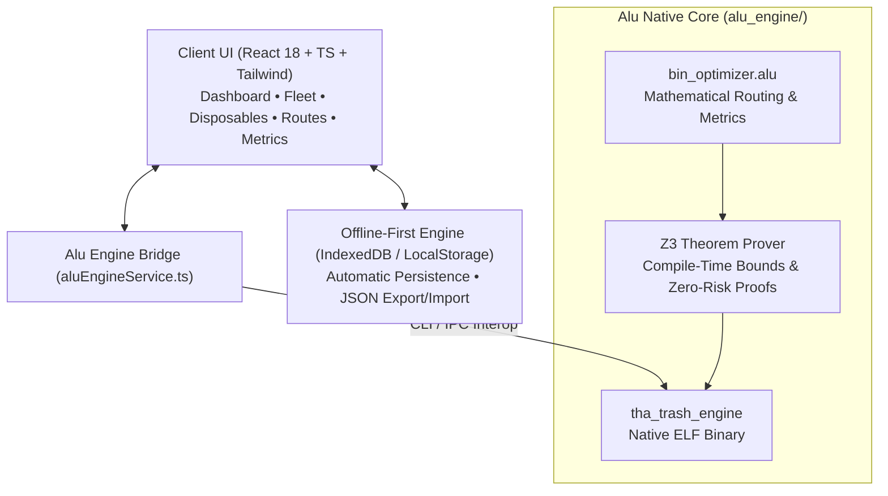

<div align="center">
  
  <h1>THa Trash App</h1>
  <p><strong>Next-Generation Smart Waste Fleet Logistics, Bin Telemetry & Disposables Inventory Engine</strong></p>
  <p><em>Built with React 18, TypeScript, Tailwind CSS, and a Z3-Verified <a href="https://github.com/Alu6hel/alu-language">Alu Language</a> Native Core</em></p>

  <p>
    
    
    
    
  </p>
</div>

---

## 🌟 Overview

**THa Trash App** is a high-performance municipal, enterprise, and campus waste management platform designed to eliminate overflowing receptacles, monitor single-use disposables inventory, and optimize waste collection routes.

By fusing a reactive web client with a **mathematically-proven native engine written in the [Alu Language](https://github.com/Alu6hel/alu-language)**, the application predicts receptacle overflow hours, ranks collection stops by hazard/urgency score, and provides verifiable EPA WARM greenhouse gas diversion metrics.

---

## 🏗️ System Architecture



---

## ⚡ Core Features

### 🗄️ Smart Bin Fleet Monitoring
- **Live Ultrasonic Telemetry:** Simulated or hardware-linked IoT ultrasonic level sensors with battery monitoring.
- **Five Segregated Streams:** General (Landfill), Recyclables (Plastics/Paper/Metals), Compost (Organics), Hazardous / Biohazard, and E-Waste.
- **Dynamic Risk Modeling:** Automatically calculates hours until overflow and classifies bins into `Normal`, `Attention`, or `Critical (≥85%)`.
- **Instant Empty Logging:** Field technicians can record collected weight (kg), volume (L), technician credentials, and flag contamination incidents.

### 📦 Disposables & Consumables Lifecycle
- **Upstream Waste Tracking:** Monitors disposable stock (compostable PLA cups, nitrile gloves, paper towels, cutlery) *before* they enter the waste stream.
- **Burn-Rate Forecasting:** Alu mathematical algorithms compute depletion rates and project exact days remaining until exhaustion.
- **Restock Alerts:** Automated reorder warnings whenever stock breaches defined safety thresholds.
- **Carbon Footprint Rating:** Tracks embedded carbon footprint (grams CO₂e per unit) and provides proper disposal stream guidance.

### 🧠 Native Alu Language Engine (`alu_engine/`)
- Built using the **Alu Systems Programming Language** (`.alu` files) compiled via `alu_cxx`.
- **Z3 Theorem Prover Verified:** Enforces formal mathematical pre-conditions (`@requires(fill_rate > 0)`) guaranteeing zero division-by-zero risks and strict array bounds safety.
- **Multi-Variable Priority Scoring:**
  $$\text{Priority} = (\text{FillPct} \times 6) + \text{StreamWeight} + \text{TimeDecayBonus} + \text{RapidFillBonus}$$
- **Landfill Diversion & Carbon Offset:** Calculates percentage of waste diverted from landfills and metric kilograms of CO₂e avoided.

### 🗺️ Dynamic Route Optimizer
- Generates optimal collection sequences sorted by urgency, prioritizing overflowing and hazardous receptacles.
- Interactive collection manifest for custodial staff with one-tap completion checkboxes.
- Live collection truck capacity utilization meter (e.g. 1,200L payload tracking).

### 🏷️ Printable Smart Placards & QR Tags
- Generates high-contrast printable placards for physical bin labeling with vector QR codes for quick field identification.

---

## 💻 Alu Engine Code Example (`alu_engine/bin_optimizer.alu`)

Here is an excerpt from the native Alu engine showcasing the Z3 contract enforcement:

```alu
// Predict hours until a bin reaches 100% capacity
// @requires clause mathematically guarantees denominator > 0 to Z3
@requires(fill_rate_per_hour > 0)
routine calculate_overflow_hours(int current_fill_pct, int fill_rate_per_hour) -> int {
    if (current_fill_pct >= 100) {
        return 0;
    }
    int remaining_pct = 100 - current_fill_pct;
    int hours = remaining_pct / fill_rate_per_hour;
    return hours;
}

// Calculate Landfill Diversion Rate (Percentage 0-100)
@requires(total_kg > 0)
routine calculate_diversion_rate_pct(int diverted_kg, int total_kg) -> int {
    int rate = (diverted_kg * 100) / total_kg;
    return rate;
}
```

---

## 🚀 Quickstart & Installation

### 1. Web Application

```bash
# Clone the repository
git clone https://github.com/Alu6hel/THa-Trash-app.git
cd THa-Trash-app

# Install dependencies
npm install

# Start development server
npm run dev

# Build production bundle
npm run build
```

### 2. Native Alu Optimization Engine

The native Alu engine can be compiled and verified using the Alu toolchain:

```bash
# Navigate to alu_engine
cd alu_engine

# Compile with alu_cxx
bash build_alu.sh

# Run tests and simulation
./bin/tha_trash_engine
```

### 3. Automated Verification Suite

Run the full end-to-end audit:

```bash
node scripts/test_e2e_verification.mjs
```

---

## 📊 Waste Stream Specifications

| Waste Stream | Alu Code | Hazard Weight | EPA Carbon Factor | Target Items |
| :--- | :---: | :---: | :---: | :--- |
| **General** | `1` | 50 | 0.0 kg CO₂e / kg | Non-recyclable film, wrappers, soiled packaging |
| **Recyclables** | `2` | 80 | 2.8 kg CO₂e / kg | Clean PET/HDPE bottles, aluminum cans, clean paper |
| **Compost** | `3` | 120 | 0.5 kg CO₂e / kg | Food scraps, BPI ASTM D6400 certified PLA, organics |
| **Hazardous** | `4` | 250 | Special | Biohazard sharps, lab chemicals, medical supplies |
| **E-Waste** | `5` | 90 | 3.5 kg CO₂e / kg | Lithium batteries, electronics, circuit boards |

---

## 🛡️ License & Credits

- Created by **David Jones** ([@Alu6hel](https://github.com/Alu6hel)).
- Powered by the **[Alu Programming Language](https://github.com/Alu6hel/alu-language)**.
- Licensed under the **MIT License**.
